  
  
  
  

 

 
 

<h3>
  <code>01</code>&nbsp; What I do
</h3>

 
 

<h3>
  <code>02</code>&nbsp; Toolbox
</h3>

<table>
  <tr>
    <td width="160"><b>LANGUAGES</b></td>
    <td></td>
  </tr>
  <tr>
    <td><b>FRONTEND</b></td>
    <td></td>
  </tr>
  <tr>
    <td><b>BACKEND &amp; DATA</b></td>
    <td></td>
  </tr>
  <tr>
    <td><b>TOOLING</b></td>
    <td></td>
  </tr>
</table>

 

<h3>
  <code>03</code>&nbsp; Activity
</h3>

  
  

  

  

 

  

